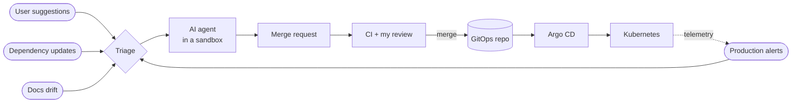

<picture>
  <source media="(prefers-color-scheme: dark)" srcset="assets/banner-dark.svg">
  <source media="(prefers-color-scheme: light)" srcset="assets/banner-light.svg">
  
</picture>

  
  
  

I'm a backend developer at **[Lãberit](https://www.laberit.com)**, building hospital software on **SINASUITE** with Java and Spring.

Outside work I build **[Costia](https://costia.app)**, a family of everyday apps with AI where it saves work. I take them end to end: product, backends, mobile clients, and the platform they run on. That platform is a GitOps cluster where AI agents do most of the routine engineering, and I review what they propose.

I'm most interested in **AI agents**, **platform engineering** and **Kubernetes**.

## 🚀 Now building: Costia

One Costia account and one Premium subscription work across every app. There are no ads in any of them.

| | App | What it does |
| :-: | --- | --- |
| 💸 | **[Costia Finance](https://costia.app/finance)** | Split bills and track spending; scan a receipt and let everyone tick theirs. iOS, Android and [web](https://finance.costia.app), with a [public API](https://docs.costia.app). |
| 🏋️ | **[Costia Training](https://costia.app/training)** | A strength log that keeps a history rather than a number and tells you what to put on the bar next. Works offline in the gym. |
| 📦 | **[Costia Inventory](https://costia.app/inventory)** | Map your home, record where things are, and find them again by searching or asking the assistant. |
| 🥗 | **[Costia Ambrosia](https://costia.app/ambrosia)** | A meal planner for the whole household that turns the week's menus into a shopping list for each supermarket. |
| 🧩 | **[Costia Claude Tools](https://costia.app/claude)** | Your Claude Code setup (skills, hooks, MCP servers, AGENTS.md rules) as a [Costia account](https://claude.costia.app): a catalogue you can install in any repo and share. |
| 🍽️ | **Costia Menu** · *in progress* | Software for restaurants: the menu on a site of its own, and ordering from the table. |

**Stack:** Spring Boot 4 on Java 25, Expo and React Native offline-first clients, PostgreSQL, and a shared platform for identity, subscriptions and AI.

## 🤖 How it ships: agents + GitOps

The apps are maintained by a pipeline of AI agents. Every signal that needs code becomes an issue, and an agent works on it in an isolated sandbox. What comes out is a merge request. **Agents propose and never merge.** I approve every change, and Git is the only path to production.

Underneath, Kubernetes operators do the heavy lifting: **Argo CD**, **External Secrets**, **cert-manager**, **ExternalDNS**, **CloudNativePG** and the **Istio Gateway API**. The **Grafana** stack provides metrics, logs and traces.

## 🛠️ Other things I've built

| Project | What it is |
| --- | --- |
| [**Manual Tasks**](https://manualtasks.dev) · [repo](https://github.com/javirub/claude-manual-todos-plugin) | A Claude Code plugin that records the manual steps only you can do (a console setting, a secret to seed, a review to answer) and lays them out on a board. |
| [**CubeDojo**](https://cubedojo.app) | A speedcubing app: a WCA-faithful timer, a path from the beginner method to full CFOP, and trainers for every case set. |
| [**Supermarket recommender**](https://market.javirub.pro) | My degree's final project: a supermarket web shop that suggests personalised, sustainable recipes and favours products that are about to expire. Spring Boot, React, Elasticsearch hybrid search and an LLM. |
| [**gq**](https://github.com/javirub/gq) | A `yq`-compatible YAML/JSON processor that preserves Go template syntax in `.gotmpl` files, built for Helmfile. `Go` |
| [**glaber**](https://github.com/javirub/glaber) | A desktop app for GitLab API chores without scripting: CI/CD variables, projects and package uploads. `Tauri` `React` |
| [**helm-utils**](https://github.com/javirub/helm-utils) | Helm and Helmfile utilities, including a JSON Schema generator for `values.yaml`. `Bash` |
| [**Mirage**](https://github.com/javirub/Mirage) | A proxy that deploys on Vercel's free tier. `TypeScript` |

### Open source contributions

- **external-secrets**: [fix(gitlab): return NoSecretErr for missing variables and allow empty values](https://github.com/external-secrets/external-secrets/pull/6510) (open)
- **expo**: [docs: recommend maintained React Native passkey library](https://github.com/expo/expo/pull/49404) (open)
- **SchemaStore**: [Helmfile schema fixes and new fields](https://github.com/SchemaStore/schemastore/pull/5033) (merged)

## 🧰 Tech stack

  
   
  
   
  

      

## 🌍 Languages

Spanish and Catalan (native) · English (professional)
